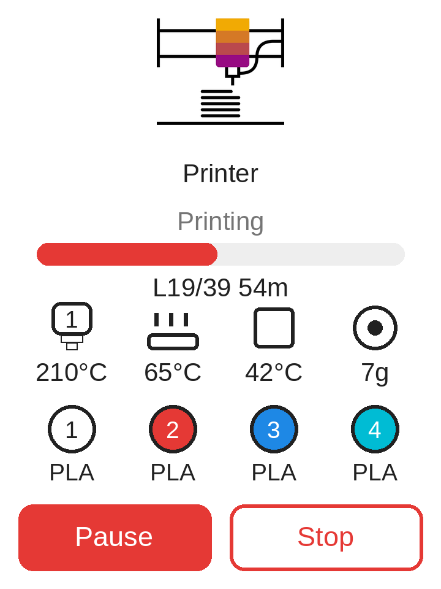
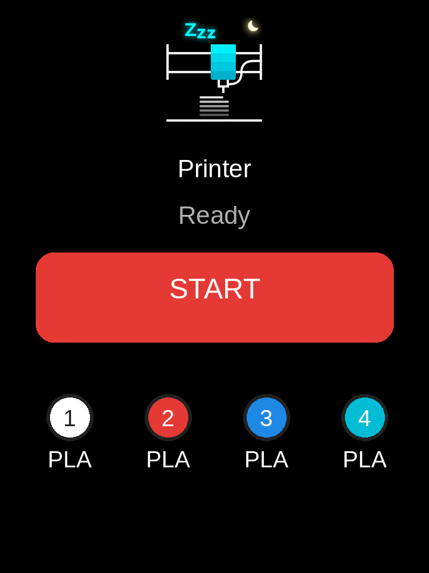
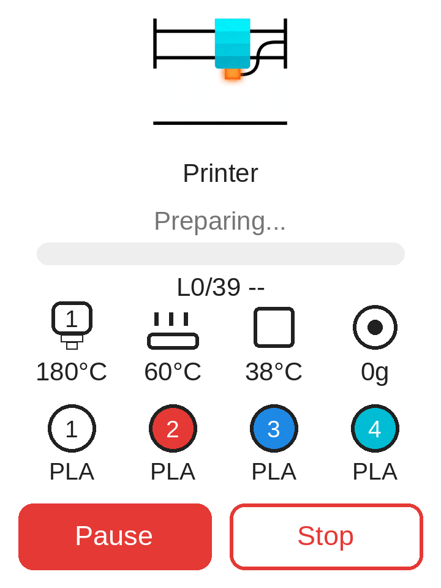
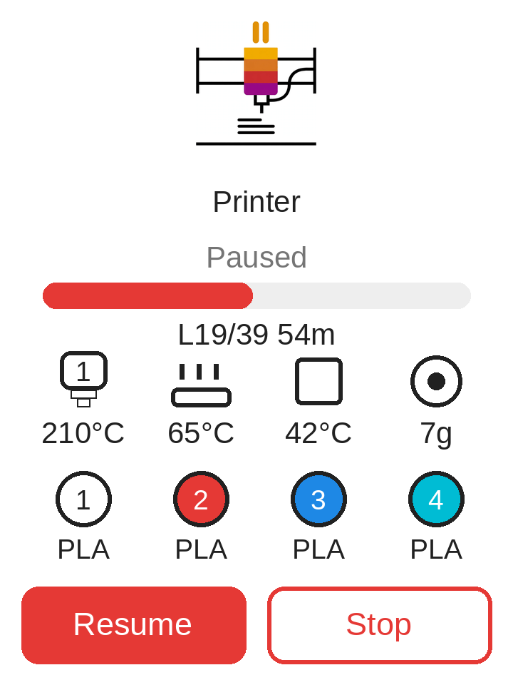
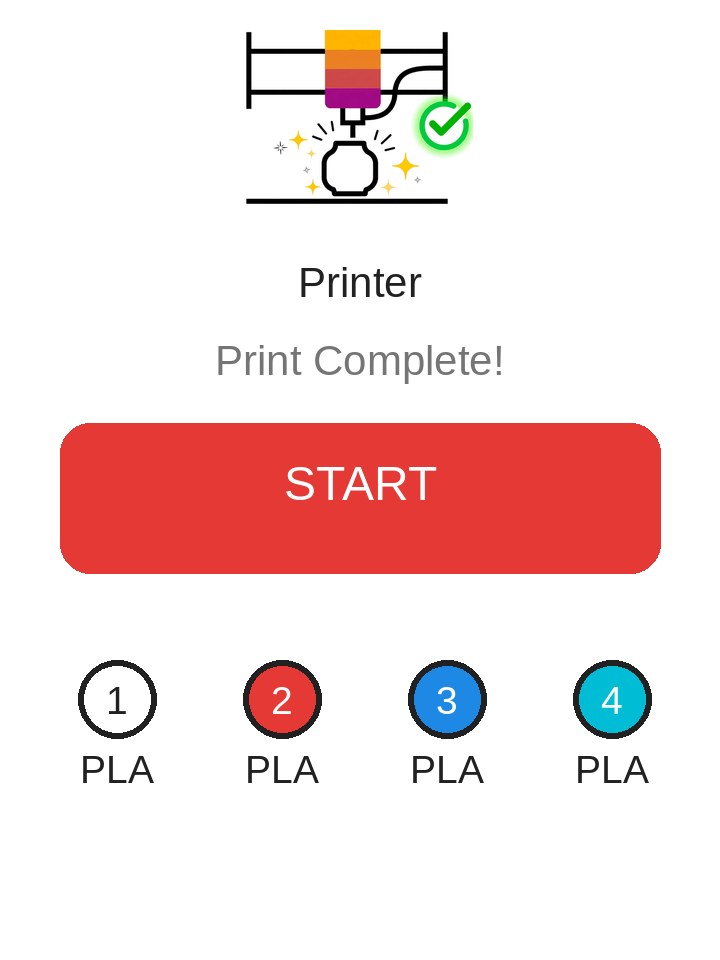
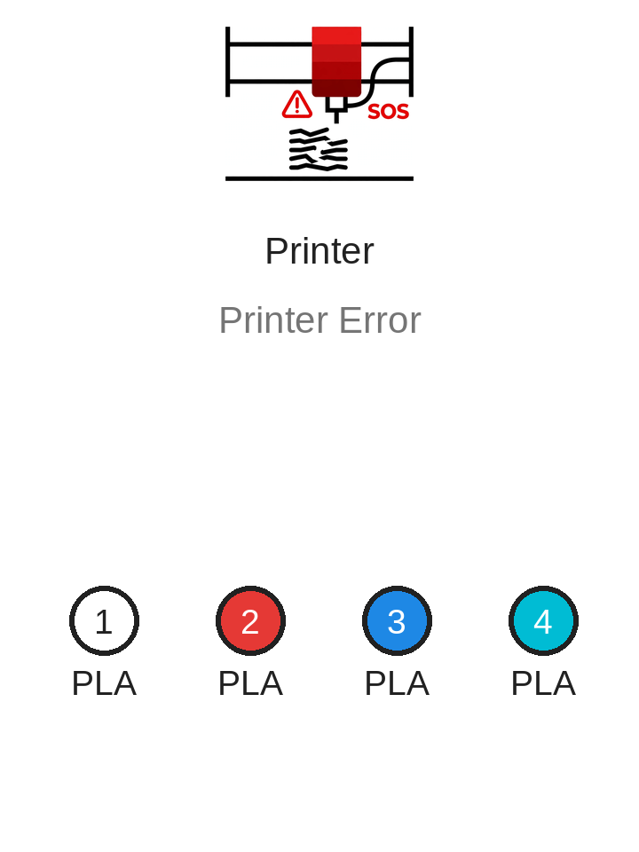

<!-- Paste into README.md, e.g. right after the intro / features section.
     The 6 sim-*.png files must be added to the repo's docs/ folder.
     They are faithful renders of the actual screens. -->

## Screenshots

| | |
|---|---|
| **Printing** — v2.0 dashboard: progress, layer, remaining time, active hotend / bed / chamber temperatures, filament used in grams, and the 4-slot filament row | **Idle / Ready** — START opens the file browser; filament row stays visible |
|  |  |
| **Preparing** — heating up before the print starts | **Paused** — Resume or Stop, with confirmation |
|  |  |
| **Print Complete** | **Error** |
|  |  |
