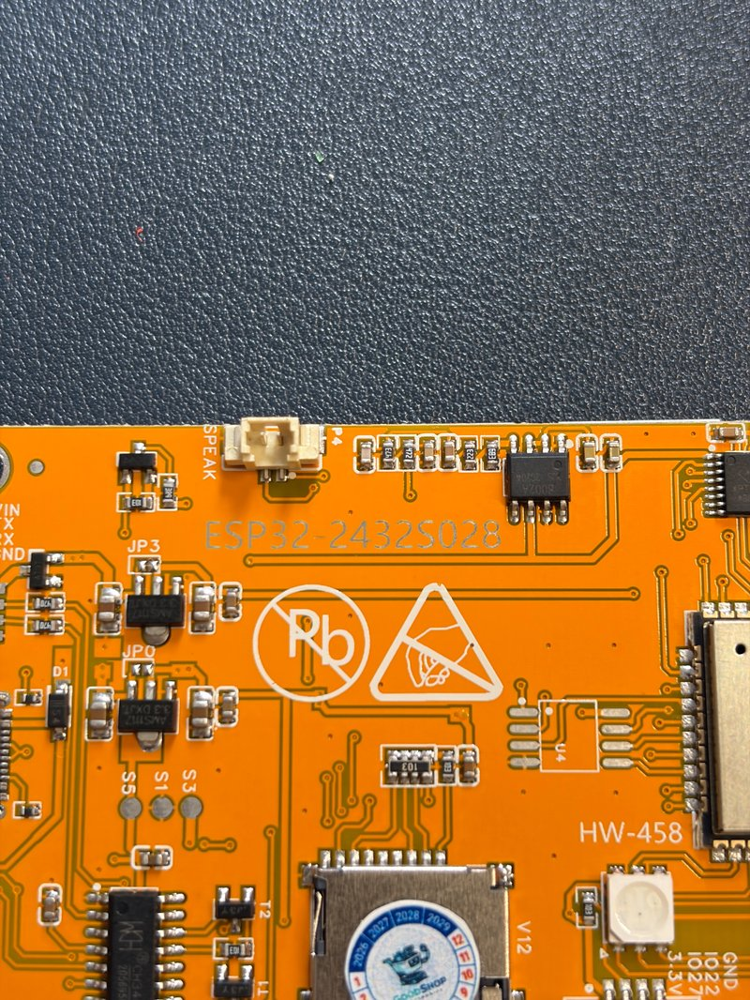
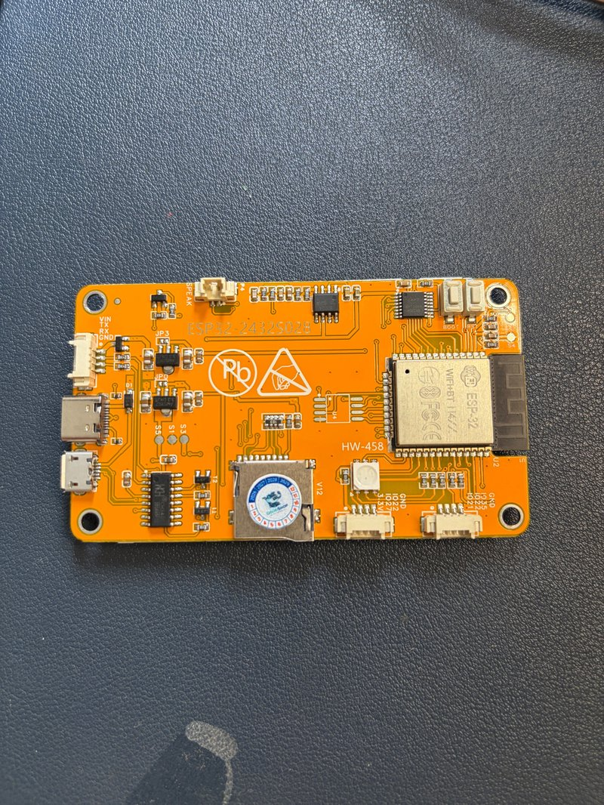
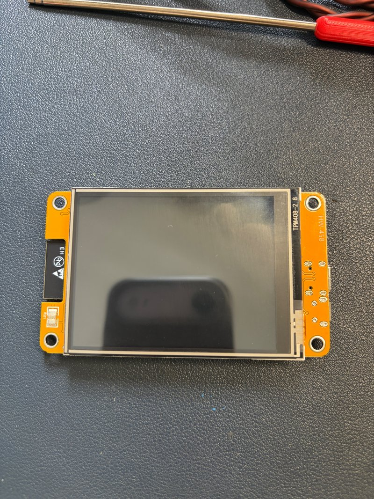

# 🖨️ SnapDaddy

Custom Klipper display firmware for the Snapmaker U1 — based on [CYD-Klipper](https://github.com/printorems/cyd-klipper), reworked with a portrait UI, animated status screens, and one-tap printing.

**👉 Flash it from your browser: [khuong.cloud](https://khuong.cloud/)** — no software to install.

If you like this project, consider [☕ buying me a coffee](https://buymeacoffee.com/khuongka).

> **📩 Need custom firmware or have any questions? Contact me on WhatsApp: `wallenme`**
>
> If you have any ideas for improvement or suggestions, please message me directly. Thank you very much!

## About

This project takes the excellent **CYD-Klipper** firmware and optimizes it for the **Snapmaker U1** (4 hotends + heated chamber). The stock landscape UI is replaced with a purpose-built portrait interface: animated state illustrations, a file browser with thumbnails, and large touch-friendly controls.

Questions, feature requests, or bug reports? Open an issue on GitHub or reach out — happy to help.

## What's new in v2.1.0

- **New ACE Pro build**: an optional variant with an on-screen ACE control panel — load/unload each toolhead and control the dryer (start/stop, temperature, duration) — for Anycubic ACE Pro / ACE Pro 2 units connected to the printer through [multiACE](https://github.com/decay71/multiACE)
- **Home-screen printer name**: the title now shows the printer name set on the display (Rename Printer); if no name is set, the title is hidden instead of showing an IP address
- **Screen timeout**: the display sleeps after 5 minutes without touch by default (adjustable in Settings → Wake Timeout) instead of staying on forever

## Hardware requirements

- **Display:** CYD 2.8" — ESP32-2432S028R (no PSRAM variant)
- **Printer:** Snapmaker U1 running Klipper + Moonraker (port `7125`)
- **Network:** 2.4 GHz Wi-Fi (display and printer on the same network)
- **Slicer:** OrcaSlicer / Snapmaker Orca with `32x32` thumbnails enabled for preview images

| Front | Back | Detail |
|---|---|---|
|  |  |  |

## Video guide

[](https://youtu.be/nsUZelU09KI)

## Screenshots

| **Printing** | **Idle / Ready** |
|---|---|
|  |  |
| **Preparing** | **Paused** |
|  |  |
| **Print Complete** | **Error** |
|  |  |

- **Printing** — v2.0 dashboard: progress bar, current/total layer, remaining time, active hotend / bed / chamber temperatures, filament used in grams, and the 4-slot filament row
- **Idle / Ready** — START opens the file browser; the filament row stays visible
- **Preparing** — heating up before the print starts
- **Paused** — Resume or Stop, with confirmation
- **Print Complete** — shown when a print finishes
- **Error** — the printer's error state at a glance

## How it works

The display connects to Moonraker over Wi-Fi and mirrors the printer's state in real time. The screen automatically switches illustration and layout per state:

- **Idle / Ready** — dark sleeping screen with a calm moon animation. Tap **START** to browse `.gcode` files stored on the printer — each with its thumbnail — then confirm to print
- **Printing** — animated printer illustration, live progress bar, current/total layer, remaining time, and the v2.0 dashboard (active hotend, bed, chamber, filament used) with **Pause/Resume** and **Stop**
- **Preparing** — heating animation while the printer warms up the hotend and bed before printing starts
- **Paused** — dedicated pause animation; tap **Resume** to continue (with confirmation)
- **Complete** — celebration animation when a print finishes; returns to idle automatically after 15 minutes
- **Error** — red alert animation with the printer's error message, so you notice a failed print at a glance

## Flash the firmware

Flash directly from your browser (Chrome/Edge) — no software to install:

👉 **[Flash via khuong.cloud](https://khuong.cloud/)**

Two builds are offered — **Standard** for most users, and **with ACE Pro control** if your printer runs an Anycubic ACE Pro / ACE Pro 2 through multiACE (it adds an on-screen ACE panel: load/unload per toolhead + dryer controls).

Steps:
1. Connect the CYD display to your computer via USB.
2. Open the page above in Chrome or Edge and click **Install**.
3. Pick the display's serial port and wait 1–2 minutes, then let the display reboot.
4. After boot, **hold BOOT for 8 seconds** and touch the two calibration points to calibrate the touchscreen.

> ⚠️ **Please note:** installing erases the device completely, including saved Wi-Fi settings. This is required — this build uses the `min_spiffs` partition layout, and skipping the erase can cause a black screen. Just re-enter your Wi-Fi after flashing.

## Building from source

Requires [PlatformIO](https://platformio.org/):

```bash
git clone https://github.com/khuonguyenhcm-bit/CYD-U1.git
cd CYD-U1
# Open in VS Code with the PlatformIO extension, select the esp32-2432S028R
# environment, then Build + Upload. The board auto-enters download mode —
# no need to hold BOOT during upload.
```

## Common questions

**Which display does this firmware use?**
The 2.8" CYD — `ESP32-2432S028R` (240×320, resistive touch). Use that exact model; other boards are not supported by this build.

**Does it work on the Snapmaker U1?**
Yes — it was built and tuned for the Snapmaker U1 (4 hotends + heated chamber).

**Does it work with other printers?**
Yes — any printer running **Klipper + Moonraker** (Voron, Ender 3 with Klipper, Prusa with Klipper, Elegoo Neptune 4, …). Enable Moonraker on port `7125` and use the display's auto-scan to connect. The filament row reads Snapmaker U1 data and simply stays hidden on other printers.

**Does it support the Anycubic ACE Pro?**
Yes — flash the **v2.1.0 with ACE Pro control** build. The ACE connects to the printer through [multiACE](https://github.com/decay71/multiACE) (installed on the printer itself); the display then gets an ACE panel for loading/unloading each toolhead and running the dryer.

**Is there a bigger-screen version?**
Not yet — a 3.5" CYD (`ESP32-3248S035`, capacitive-touch C variant, ~$15–20) is being evaluated. The current layout is designed for 2.8" 240×320, so it needs resizing first. Expected price well under $40.

**Will there be notification sounds?**
Yes — a version with a small chime when a print starts and finishes (Bambu Lab style) is in development.

**How much does it cost? Can I buy one?**
This is a hobby project, not a product — the firmware is free, and I don't sell displays. Flash it yourself with the installer above.

**Black screen after flashing from the website?**
The web installer now **erases the display automatically** and flashes the complete image (bootloader + partitions + firmware) — a skipped erase with an incomplete flash was the cause. If you flashed before this fix, just run the web installer again.

**Boot loop — console repeats `invalid header: 0xffffffff`?**
Your board is not damaged, and dual-USB (micro USB + USB-C) CYD boards are supported. This was an installer bug: older v1.1/v1.2 manifests wrote only the app firmware, so after an erase the chip had no bootloader or partitions to boot from. All manifests were fixed and verified on 2026-10-12 — just run the web installer again; it erases automatically and writes the complete image, and the board comes back to life. No special tools needed.

**Touches land in the wrong place / keyboard hits the wrong keys?**
Redo the touchscreen calibration: with the display powered on, **hold BOOT for 8 seconds**, release, then tap the two crosshairs as precisely as you can. The first boot after every web flash asks for this — tap carefully, small keys need it.

## Version History

### v2.1.0
- **New ACE Pro build**: an optional variant with an on-screen ACE control panel — load/unload each toolhead and control the dryer (start/stop, temperature, duration) — for Anycubic ACE Pro / ACE Pro 2 units connected to the printer through multiACE
- **Home-screen printer name**: the title now shows the printer name set on the display (Rename Printer); if no name is set, the title is hidden instead of showing an IP address
- **Screen timeout**: the display sleeps after 5 minutes without touch by default (adjustable in Settings → Wake Timeout) instead of staying on forever

### v2.0.1
- **True U1 filament colors**: the filament row and the hotend icon now snap to the closest color from the U1's own 22-color palette (sampled from the printer's Filament Details screen) instead of approximating — pale cyan, pinks and reds now display correctly
- **Empty slots**: a slot with no filament now shows as a circle with a diagonal slash and an "Empty" label
- **Active extruder tracking**: the hotend badge now follows the printer's reported active extruder, so it switches correctly during toolchanges on multi-color prints (thanks Rich!)

### v2.0
- **Filament row**: all 4 slots shown on the home screen with their filament color and material type, read live from the printer (Snapmaker U1). Colors are normalized the same way the printer's own screen shows them
- **New printing dashboard**: the temperature table is replaced by a compact row — active hotend with its temperature, bed, chamber, and filament used so far in grams. The hotend icon is tinted with the color of the filament being printed
- **Screen always on**: the display no longer turns off by itself
- Fixed the "authorisation" spelling in the Klipper setup screens (thanks Rich!)

### v1.3.1
- **File list readability**: filenames in the Choose file menu were white text on a white background — now dark and clearly readable
- **File list fits the screen**: the list no longer scrolls sideways; it is sized for the portrait display and scrolls vertically only
- **Print confirmation dialog**: the Print File dialog overflowed the portrait screen and clipped long filenames — now sized correctly
- **Bambu access codes**: the access code field now accepts letters as well as numbers (full keyboard), so hex codes can be entered

### v1.3
- **Setup screens fixed**: WiFi and printer setup no longer overflow the portrait display (the keyboard was cut off and buttons ran off-screen)
- **Find Printer in setup**: Klipper setup can scan your WiFi and fill in the printer IP automatically, plus a Connect button for manual entry
- **Touch calibration fix** for rotated screens (recalibrate once after flashing)
- Klipper port now defaults to 7125 (Moonraker), and printer auto-scan is faster

### v1.2
- **Auto-scan printer**: if the display can't reach the printer for 3 minutes, it scans your WiFi for Moonraker and reconnects automatically
- **Find Printer button**: tap to scan immediately instead of waiting

### v1.1
- New **Preparing** state: heating animation while the printer warms up before printing
- New **Complete** state: celebration animation when a print finishes (auto-returns to idle after 15 min)
- New **Paused** state: dedicated pause animation
- **Pause/Stop confirmation**: tap Pause or Stop now asks for confirmation before acting
- All status animations enlarged by 10%

### v1.0
- Initial public release: portrait UI, animated Idle/Printing/Error screens, file browser with thumbnails, print confirmation, 4-hotend + chamber temps

## About me

**khuong nguyen** — Maker · food lover · gadget enthusiast

[Facebook](https://facebook.com/ngkhuong) · [Instagram](https://instagram.com/wallenme) · WhatsApp: `wallenme`

I love good food and tinkering with electronics. This CYD display project started as a weekend experiment for my Snapmaker U1 and grew into something worth sharing.

## License

Based on [CYD-Klipper](https://github.com/printorems/cyd-klipper). Custom UI by khuong nguyen.
